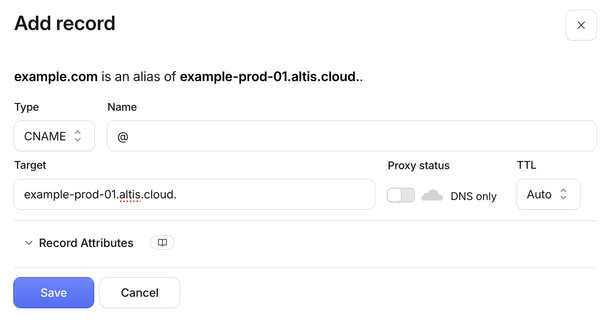
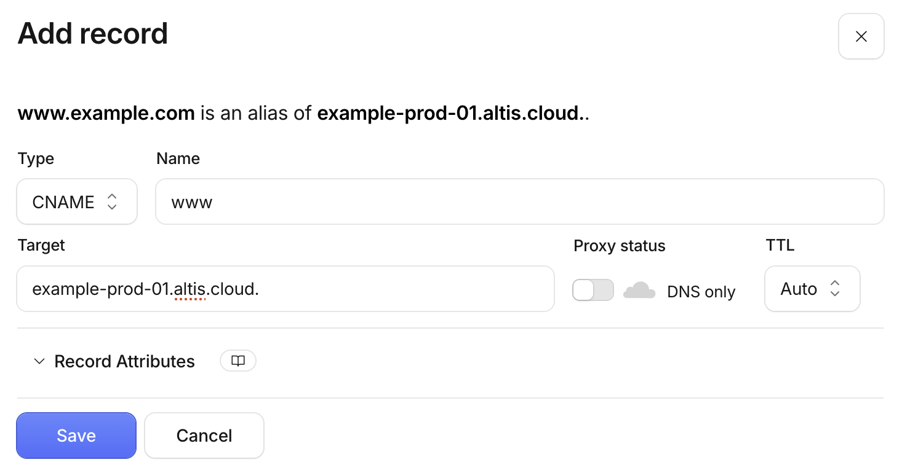

# How do I point my domain to Altis using Cloudflare DNS?

Create a CNAME record for each domain, pointing to your environment's Altis domain, and set the proxy status to **DNS only**. Your
environment's Altis domain, such as `example-prod-01.altis.cloud`, is shown in the Altis Dashboard once you add your domain.

For the domain apex, such as `example.com`, set the name to `@`. Cloudflare uses CNAME flattening to support CNAME records on the
apex, so no ALIAS or ANAME record is needed.

For a subdomain, such as `www.example.com`, set the name to the subdomain.

## Why must the proxy status be set to DNS only?

Altis already serves your site through its own CDN and firewall. When the Cloudflare proxy is on, Cloudflare's CDN sits in front of
the Altis CDN. This causes problems that are hard to diagnose, for example:

- SSL errors, such as Cloudflare's 525 error
- Errors and rate limiting applied by Cloudflare, which do not appear in Altis logs
- Caching rules from both CDNs applying to the same request

Before you switch DNS, remove any existing A, AAAA or CNAME records for the same names. Records left in place split traffic between
your old host and Altis.

## Why does my domain fail validation?

If your domain has CAA records, they must allow Amazon to issue certificates. Otherwise SSL validation fails. See the
[AWS guide to CAA records](https://docs.aws.amazon.com/acm/latest/userguide/setup-caa.html).

See also: [DNS Configuration](docs://cloud/dns-configuration/)
